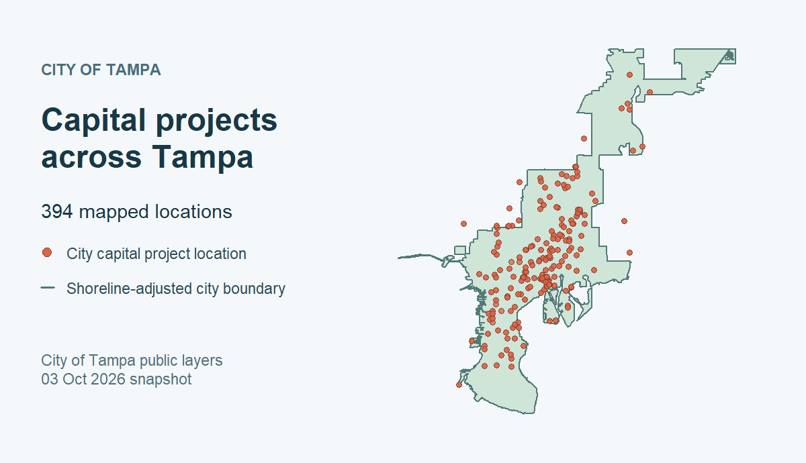

# tampaBayOpenData

<!-- badges: start -->
[](https://CRAN.R-project.org/package=tampaBayOpenData)
[](https://github.com/Jaclenga/tampaBayOpenData/blob/main/LICENSE.md)
[](https://github.com/Jaclenga/tampaBayOpenData/actions/workflows/R-CMD-check.yaml)
[](https://github.com/Jaclenga/tampaBayOpenData/actions/workflows/pkgcheck.yaml)
[](https://github.com/Jaclenga/tampaBayOpenData/actions/workflows/test-coverage.yaml)
<!-- badges: end -->

tampaBayOpenData provides a lightweight R interface for discovering and retrieving public ArcGIS datasets across the Tampa Bay region. The package lets users search for civic datasets and load them directly into R without manually navigating ArcGIS portals, constructing REST API requests, or handling pagination themselves.

It currently supports public data published by:

- City of Tampa
- City of St. Petersburg
- City of Clearwater
- Hillsborough County
- Pinellas County
- Tampa Bay Regional Planning Council

Designed for analysts, researchers, students, journalists, and civic technologists, tampaBayOpenData provides a consistent workflow across ArcGIS publishers that otherwise expose data through separate portals and services.

**New to tampaBayOpenData? [Start with the five-minute tutorial.](https://jaclenga.github.io/tampaBayOpenData/articles/first-five-minutes.html)**

## Install

Install the released package from CRAN:

```r
install.packages("tampaBayOpenData")
```

For the development version from GitHub:

```r
install.packages("pak") # if needed
pak::pak("Jaclenga/tampaBayOpenData")
```

Install `sf` as well if you need spatial results.

## Find and retrieve a checked layer

```r
library(tampaBayOpenData)

parks <- tbod_search_datasets("parks", source = "checked")
parks[, c("id", "title", "publisher")]

data <- tbod_get_dataset("stpete-parks", limit = 100)
tbod_provenance(data)[c("publisher", "source_url", "retrieved_at", "complete")]
```

The search reads the bundled catalog; retrieval contacts the publisher.
Checked search ranks exact titles and IDs before partial and metadata matches.
It can recover a close spelling when no checked entry matches literally.
Use `limit` to return the first ranked search rows; it is separate from the
`max_items` cap on live service items scanned.

The retrieval call's `limit = 100` returns a record subset, recorded as
incomplete in its provenance when more records match. Omit the retrieval
`limit` to request all matching records, subject to the service and package
limits described in the retrieval guide.

A **checked** layer has a catalog entry and a saved field, geometry, and CRS
snapshot. Before retrieval, its live metadata is compared with that snapshot:
compatible changes warn; incompatible changes stop the request. Checked status
does not verify individual records or guarantee the service will remain
available. See [schema checks and retrieval](https://jaclenga.github.io/tampaBayOpenData/articles/retrieval.html#check-the-live-schema).
For common failures and recovery steps, see [Troubleshooting common errors](https://jaclenga.github.io/tampaBayOpenData/articles/retrieval.html#troubleshooting-common-errors).

To inspect current endpoint and schema health across checked entries, run
`tbod_check_catalog()` or select a few IDs with
`tbod_check_catalog(ids = "stpete-parks")`. It contacts the publishers and
returns one diagnostic row per entry. Add `probe_query = TRUE` to test a
zero-match count query without downloading records. Each row records when it
was checked, elapsed request time, HTTP status when available, and a failure
reason. `query_status` reports whether the count operation was verified.
`health_state` groups results as `healthy`, `degraded`, `unavailable`, or
`unknown`; the existing `status` gives the more specific diagnosis.
Absent another confirmed problem, transient failures are `unknown` rather than
proof that a layer is gone.

The [daily catalog-health workflow](https://github.com/Jaclenga/tampaBayOpenData/actions/workflows/catalog-health.yaml)
runs the query probe for every checked entry and uploads timestamped JSON,
RDS, CSV, and Markdown reports. It never updates the bundled catalog. These
reports are point-in-time checks of selected layers; they do not measure record
freshness or establish complete publisher coverage. See the [test and report
guide](https://github.com/Jaclenga/tampaBayOpenData/blob/main/tests/README.md#live-and-package-checks)
for local commands.

## Search beyond the catalog

Live discovery searches the six configured ArcGIS publishers. For example,
`tbod_search_datasets("housing", source = "live", portals = "city")` searches
Tampa's portal. To search another public ArcGIS portal, supply its sharing
REST root:

```r
# Replace this address with the public sharing REST root of your portal.
other <- tbod_discover("https://example.maps.arcgis.com/sharing/rest",
                       query = "parks")
if (nrow(other)) tbod_get_dataset(other[1, ], limit = 100)
```

Portal results have `discovered` status; rows from a service or layer URL have
`not_checked` status. Both work with `tbod_get_dataset()` and have no saved
checked schema. Live searches can miss items when the scan is bounded or a
publisher service fails; inspect `attr(other, "discovery_complete")` before
treating a result as a complete listing. A direct public `FeatureServer/<id>`
or `MapServer/<id>` URL also works with `tbod_get_dataset()`. The [discovery](https://jaclenga.github.io/tampaBayOpenData/articles/discovery.html)
and [retrieval](https://jaclenga.github.io/tampaBayOpenData/articles/retrieval.html)
articles cover filters, scan limits, direct URLs, and downloads.

## See spatial data

The checked City of Tampa `city-boundary` and `capital-projects` layers can be
retrieved as `sf` objects with `spatial = TRUE`.



*City of Tampa data retrieved October 3, 2026 (both ArcGIS items marked CC0).
The shoreline-adjusted boundary is not a legal survey; the points do not
establish current project status or complete coverage. [Reproduce the
map](https://github.com/Jaclenga/tampaBayOpenData/blob/main/tools/render-home-map.R)
or follow the [spatial walkthrough](https://jaclenga.github.io/tampaBayOpenData/articles/introduction.html#work-with-spatial-data).*

## Coverage and source limits

The 52 checked layers are selected references, not a complete inventory or
uniform coverage of each topic. Publisher services can change, and some layers
are active views or approximate boundaries. The TBRPC storm surge layer is a
historical planning model, not current emergency guidance. See the [coverage
guide](https://jaclenga.github.io/tampaBayOpenData/articles/coverage.html)
for publisher counts, layer caveats, and reuse terms, and the [catalog
policy](https://github.com/Jaclenga/tampaBayOpenData/blob/main/docs/checked-catalog-policy.md)
for selection and maintenance decisions. The package's MIT license covers its
code, not the source data. The package is independent of the publishers and
rOpenSci.

The [dashboard methodology and build steps](https://github.com/Jaclenga/tampaBayOpenData/blob/main/docs/coverage-dashboard.md)
explain how checked-layer counts and optional health reports appear on the
coverage page. Missing or stale health evidence is marked **unverified**.

## Practical tutorials

- [Housing and development activity](https://jaclenga.github.io/tampaBayOpenData/articles/housing-development.html): discover checked layers, summarize Tampa development cases, and inspect a Pinellas assisted-housing inventory.
- [Water quality around Tampa Bay](https://jaclenga.github.io/tampaBayOpenData/articles/water-quality.html): assess missing observations and compare reported monitoring measurements.
- [Infrastructure and capital projects](https://jaclenga.github.io/tampaBayOpenData/articles/infrastructure-projects.html): inspect project rows, types, and phases without treating map features as unique projects.

The tutorials use checked source IDs and fields. Their live retrieval and
plotting code runs when you follow a tutorial locally; pkgdown builds do not
contact the publishers. Install `ggplot2` to run the plotting examples.

## Citation

Cite the package and the original data publisher and dataset. For the package
citation, run:

```r
citation("tampaBayOpenData")
toBibtex(citation("tampaBayOpenData"))
```

`tbod_dataset_info(id)` gives catalog source details;
`tbod_provenance(result)` records the retrieval source and time.

## Learn more

- [Get started](https://jaclenga.github.io/tampaBayOpenData/articles/introduction.html)
  and [function reference](https://jaclenga.github.io/tampaBayOpenData/reference/index.html)
- [Discovery](https://jaclenga.github.io/tampaBayOpenData/articles/discovery.html),
  [retrieval and downloads](https://jaclenga.github.io/tampaBayOpenData/articles/retrieval.html),
  and [coverage and provenance](https://jaclenga.github.io/tampaBayOpenData/articles/coverage.html)
- [Developer document index](https://github.com/Jaclenga/tampaBayOpenData/tree/main/docs),
  [architecture](https://github.com/Jaclenga/tampaBayOpenData/blob/main/docs/architecture.md),
  [API migration](https://github.com/Jaclenga/tampaBayOpenData/blob/main/docs/api-migration.md),
  [validation](https://github.com/Jaclenga/tampaBayOpenData/blob/main/docs/validation.md),
  and [contributing](https://github.com/Jaclenga/tampaBayOpenData/blob/main/CONTRIBUTING.md)
- [Packaged bicycle network example (R Markdown)](https://github.com/Jaclenga/tampaBayOpenData/blob/main/inst/examples/bike-network.Rmd)
  (offline by default; optional small live subset), and the
  [full-data bicycle network exploration](https://github.com/Jaclenga/tampaBayOpenData/blob/main/explorations/tampa-bicycle-network-eda.Rmd)
  (live analysis)
- [Short R data exploration stories across six publishers](https://github.com/Jaclenga/tampaBayOpenData/tree/main/explorations/stories)
