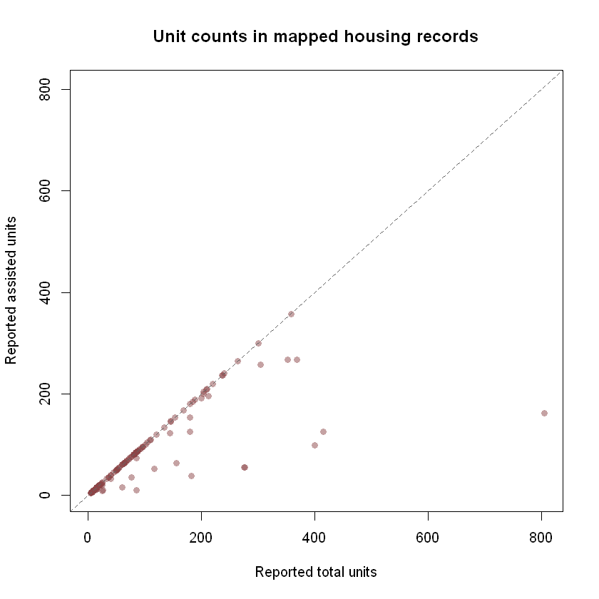

```{r setup, include=FALSE}
knitr::opts_chunk$set(collapse = TRUE, comment = "#>", eval = FALSE)
```

Count Tampa's active development-case records by neighborhood. Then inspect
a separate Pinellas assisted-housing inventory.

Catalog examples run offline. Run live examples in order with internet access.
The archived Pinellas chart is dated October 6, 2026.

## Set up

Install `tampaBayOpenData`, `knitr` for the catalog table, and `ggplot2` for
the chart:

```{r install}
install.packages("tampaBayOpenData")
install.packages("knitr")               # for the catalog table
install.packages("ggplot2")             # optional tutorial dependency
```

```{r load-package, eval=TRUE}
library(tampaBayOpenData)
```

## Find a suitable layer

Search the offline catalog:

```{r find-layers, eval=TRUE}
terms <- c("housing", "permit", "development")
matches <- lapply(terms, function(term) {
  found <- tbod_search_datasets(term, source = "checked")
  found$search_term <- term
  found[, c("search_term", "id", "title", "publisher", "category",
            "verified")]
})
catalog_hits <- do.call(rbind, matches)
knitr::kable(catalog_hits, row.names = FALSE)
```

`search_term` shows which query found each dataset.

Use `development-cases`, Tampa's active entitlement-application layer.
Permits and assisted-housing inventories cover different subjects.

```{r inspect-source, eval=TRUE}
case_info <- tbod_dataset_info("development-cases")
case_info[c("publisher", "title", "source_url", "verified",
            "scope_note", "terms")]

case_schema <- tbod_schema("development-cases")
case_fields <- c("OBJECTID", "RECORDID", "APPSTATUS", "NEIGHBORHOOD",
                 "CREATEDDATE", "LASTUPDATE")
stopifnot(all(case_fields %in% case_schema$fields$name))
case_schema$fields[match(case_fields, case_schema$fields$name),
                   c("name", "type", "alias")]
```

Check the scope, fields, and terms. `verified` dates an endpoint check,
not individual records.

## Retrieve and inspect current cases

Retrieve all matching rows and stop if the download is incomplete.

```{r retrieve-cases}
cases <- tryCatch(
  tbod_get_dataset("development-cases", fields = case_fields,
                   total_timeout = 180),
  error = function(e) {
    stop("Could not retrieve Tampa active development cases: ",
         conditionMessage(e), call. = FALSE)
  }
)

case_source <- tbod_provenance(cases)
if (!isTRUE(case_source$complete) ||
    !isTRUE(case_source$matched_rows == nrow(cases))) {
  stop("The result is incomplete; do not interpret the chart.",
       call. = FALSE)
}
case_source[c("source_url", "retrieved_at", "matched_rows",
              "returned_rows", "integrity", "complete")]
utils::str(cases[, case_fields])
head(cases[, case_fields])
```

`cases` has one row per map feature, without geometry.

`OBJECTID` identifies a feature; `RECORDID` identifies a case and may repeat.
Count feature rows here, not unique projects or housing units.

## Clean and summarize

Trim labels and convert blank values to missing. Use Eastern time for local
dates. `CREATEDDATE` records creation in the active view, not completion.

```{r clean-cases}
clean_label <- function(x) {
  out <- trimws(as.character(x))
  out[is.na(out) | !nzchar(out)] <- NA_character_
  out
}

case_data <- data.frame(
  case_id = clean_label(cases$RECORDID),
  status = clean_label(cases$APPSTATUS),
  neighborhood = clean_label(cases$NEIGHBORHOOD),
  created_date = as.Date(cases$CREATEDDATE, tz = "America/New_York"),
  stringsAsFactors = FALSE
)

nonblank_ids <- case_data$case_id[!is.na(case_data$case_id)]
quality <- data.frame(
  check = c("Mapped rows", "Missing case ID", "Repeated nonblank case ID",
            "Missing status", "Missing neighborhood", "Missing created date"),
  rows = c(nrow(case_data), sum(is.na(case_data$case_id)),
           sum(duplicated(nonblank_ids)), sum(is.na(case_data$status)),
           sum(is.na(case_data$neighborhood)),
           sum(is.na(case_data$created_date)))
)
quality

status_counts <- sort(table(case_data$status, useNA = "ifany"),
                      decreasing = TRUE)
status_counts
```

`quality` counts missing labels and ID occurrences after the first.
Missing-value counts can overlap. `status_counts` counts rows by status.

Investigate repeated case IDs before removing rows; they may mark
different locations.

## Chart the mapped neighborhoods

Plot the ten neighborhoods with the most mapped rows. Rows without
neighborhood labels remain in `quality` but are excluded from the chart.

```{r neighborhood-chart, fig.width=8, fig.height=5}
if (!requireNamespace("ggplot2", quietly = TRUE)) {
  stop("Install ggplot2 to draw the neighborhood chart.", call. = FALSE)
}

named_neighborhoods <- case_data$neighborhood[
  !is.na(case_data$neighborhood)
]
if (!length(named_neighborhoods)) {
  message("The retrieved records have no neighborhood labels to chart.")
} else {
  neighborhood_counts <- as.data.frame(table(named_neighborhoods),
                                       stringsAsFactors = FALSE)
  names(neighborhood_counts) <- c("neighborhood", "mapped_rows")
  neighborhood_counts <- neighborhood_counts[
    order(-neighborhood_counts$mapped_rows,
          neighborhood_counts$neighborhood), , drop = FALSE
  ]
  top_neighborhoods <- head(neighborhood_counts, 10)
  top_neighborhoods$neighborhood <- factor(
    top_neighborhoods$neighborhood,
    levels = rev(top_neighborhoods$neighborhood)
  )

  print(top_neighborhoods)
  neighborhood_plot <-
    ggplot2::ggplot(top_neighborhoods,
                    ggplot2::aes(x = neighborhood, y = mapped_rows)) +
      ggplot2::geom_col(fill = "#277DA1") +
      ggplot2::coord_flip() +
      ggplot2::labs(
        title = "Mapped active development cases by Tampa neighborhood",
        subtitle = paste("Top 10 labels; retrieved",
                         format(case_source$retrieved_at, "%Y-%m-%d", tz = "UTC")),
        x = NULL, y = "Mapped feature rows",
        caption = "Source: City of Tampa active development coordination cases"
      ) +
      ggplot2::theme_minimal(base_size = 12)
  print(neighborhood_plot)
}
```

The chart describes the active view at retrieval time. It cannot show
completed housing or a full historical trend.

## Look at the Pinellas housing inventory

Inspect `pinellas-assisted-housing` for reported total and assisted units.
Review repeated parcels before adding unit counts.

```{r housing-source, eval=TRUE}
housing_info <- tbod_dataset_info("pinellas-assisted-housing")
housing_info[c("publisher", "source_url", "scope_note", "terms")]

housing_fields <- c("OBJECTID", "PID", "DEVELOPMENT", "CITY",
                    "HOUSINGPROGRAM", "TOTALUNITS", "ASSISTEDUNITS")
housing_schema <- tbod_schema("pinellas-assisted-housing")
stopifnot(all(housing_fields %in% housing_schema$fields$name))
housing_schema$fields[match(housing_fields, housing_schema$fields$name),
                      c("name", "type", "alias")]
```

```{r inspect-housing}
housing <- tryCatch(
  tbod_get_dataset("pinellas-assisted-housing",
                   fields = housing_fields, total_timeout = 180),
  error = function(e) {
    stop("Could not retrieve the Pinellas assisted-housing layer: ",
         conditionMessage(e), call. = FALSE)
  }
)
housing_source <- tbod_provenance(housing)
if (!isTRUE(housing_source$complete) ||
    !isTRUE(housing_source$matched_rows == nrow(housing))) {
  stop("The housing inventory result is incomplete.", call. = FALSE)
}
head(housing[, housing_fields])
```

`PID` identifies the parcel; each row represents a source polygon.



*Illustrative snapshot from the Pinellas County assisted-housing layer,
retrieved October 6, 2026. Each point is a mapped record with usable unit
counts, not necessarily a distinct housing site. This image is historical;
run the live code above to inspect current records. Source:
[Pinellas County ArcGIS layer](https://services.arcgis.com/f5HgUpxURgEzTccH/ArcGIS/rest/services/Pinellas_AssistedHousing_view/FeatureServer/0).*

The diagonal marks equal assisted and total units. These counts do not
show current vacancies.

See the [Pinellas example](https://github.com/Jaclenga/tampaBayOpenData/blob/main/explorations/stories/05-pinellas-assisted-housing.Rmd)
for unit checks and repeated parcel IDs.

## Save and interpret

Keep `case_source` with your results to record the source and retrieval time.

Tampa's active view excludes earlier cases that have left it. Pinellas
covers a housing program inventory, without confirming eligibility or
availability. See [coverage](coverage.html) for source limits.
