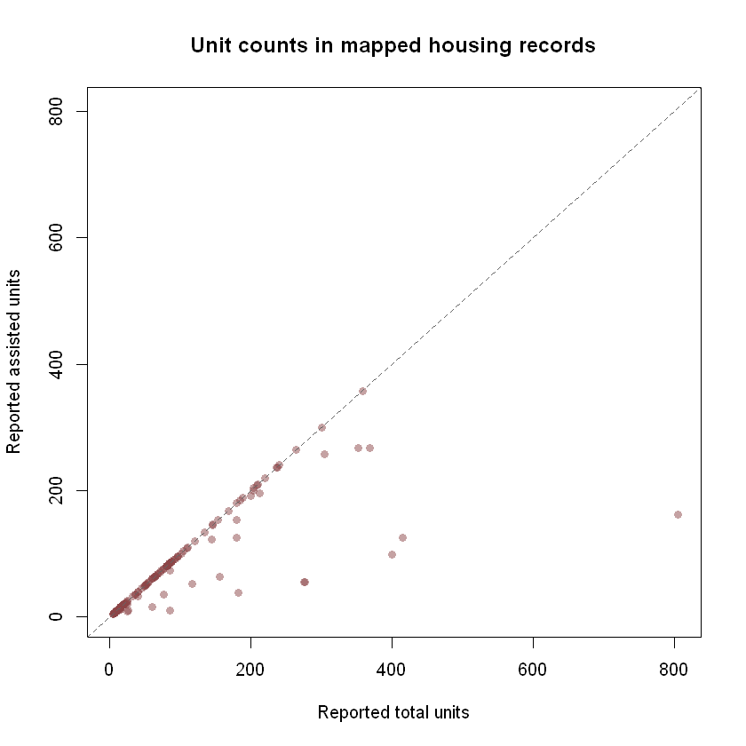

```{r setup, include=FALSE}
knitr::opts_chunk$set(collapse = TRUE, comment = "#>", eval = FALSE)
```

This walkthrough asks: **where are the cases in Tampa's current development
application map, and what statuses do its mapped records have?** You will find
a source, retrieve all its current records, check its fields, clean text
values, and chart the neighborhoods named in the layer. A separate Pinellas
County housing layer illustrates how a related question can require a
different source. The package's checked catalog is selective; these layers do
not represent all housing or development in either county.

The catalog and schema chunks below run without network access when this page
is built. **Live chunks are shown but not run during package checks or the
website build.** Run them in order in an internet-connected R session. Their
results and chart will reflect the publisher's records at the time you run
them. A dated, illustrative chart from a separate Pinellas analysis appears
below; no record-level source data is bundled here.

## Set up

Install the package from CRAN, `knitr` for the catalog table, and
`ggplot2` for the chart. The installation commands are not run when this page
is built.

```{r install}
install.packages("tampaBayOpenData")
install.packages("knitr")               # for the catalog table
install.packages("ggplot2")             # optional tutorial dependency
```

```{r load-package, eval=TRUE}
library(tampaBayOpenData)
```

## Find a suitable layer

`source = "checked"` searches bundled entries offline. Search several terms
because a permit map, an active application view, and a housing program
inventory answer different questions. The exact catalog results may change
when the package is updated.

```{r find-layers, eval=TRUE}
terms <- c("housing", "permit", "development")
matches <- lapply(terms, function(term) {
  found <- tbod_search_datasets(term, source = "checked")
  found$search_term <- term
  found[, c("search_term", "id", "title", "publisher", "category",
            "verified")]
})
catalog_hits <- do.call(rbind, matches)
knitr::kable(catalog_hits, row.names = FALSE)
```

This tutorial uses the checked City of Tampa
`development-cases` entry, a **point layer of active entitlement
applications**. The checked `construction-permits` entry is an active permit
viewer with `CREATEDDATE` and `LASTUPDATE`, but no advertised permit issue-date
field. Pinellas County's `pinellas-assisted-housing` entry describes an
assisted-housing program inventory, not every housing development. Read each
entry's scope and reuse terms before choosing a source.

```{r inspect-source, eval=TRUE}
case_info <- tbod_dataset_info("development-cases")
case_info[c("publisher", "title", "source_url", "verified",
            "scope_note", "terms")]

case_schema <- tbod_schema("development-cases")
case_fields <- c("OBJECTID", "RECORDID", "APPSTATUS", "NEIGHBORHOOD",
                 "CREATEDDATE", "LASTUPDATE")
stopifnot(all(case_fields %in% case_schema$fields$name))
case_schema$fields[match(case_fields, case_schema$fields$name),
                   c("name", "type", "alias")]
```

`verified` dates the catalog's endpoint check, not the freshness of each
record. The saved schema lists `CREATEDDATE` and `LASTUPDATE` as ArcGIS date
fields. `APPSTATUS` and `NEIGHBORHOOD` are text fields; do not assume their
values are standardized. If you need sources beyond these checked entries,
use `tbod_search_datasets("housing", source = "live")` and inspect the
discovery result's completeness and source terms as described in the
[discovery article](discovery.html).

## Retrieve and inspect current cases

Omitting `limit` requests the full matching layer. This matters for a
neighborhood comparison: an arbitrary first page would not represent all
mapped active cases. A three-minute operation budget bounds the example.
`tryCatch()` adds context if the service is unavailable or its schema has
changed; the code stops rather than making a chart from partial data.

```{r retrieve-cases}
cases <- tryCatch(
  tbod_get_dataset("development-cases", fields = case_fields,
                   total_timeout = 180),
  error = function(e) {
    stop("Could not retrieve Tampa active development cases: ",
         conditionMessage(e), call. = FALSE)
  }
)

case_source <- tbod_provenance(cases)
if (!isTRUE(case_source$complete) ||
    !isTRUE(case_source$matched_rows == nrow(cases))) {
  stop("The result is incomplete; do not interpret the chart.",
       call. = FALSE)
}
case_source[c("source_url", "retrieved_at", "matched_rows",
              "returned_rows", "integrity", "complete")]
utils::str(cases[, case_fields])
head(cases[, case_fields])
```

`RECORDID` is the source's case identifier and `OBJECTID` identifies a mapped
feature row. They may not have the same grain. The following diagnostics keep
missing labels and repeated nonblank case IDs visible. We count **mapped
rows**, not unique projects or new housing units.

## Clean and summarize

Trim whitespace and turn blank source labels into missing values. ArcGIS date
fields arrive as R date-time values; use the service's advertised Eastern time
zone when deriving a local calendar date. `CREATEDDATE` describes creation of
a record in this active view, not a permit issue or housing completion date.

```{r clean-cases}
clean_label <- function(x) {
  out <- trimws(as.character(x))
  out[is.na(out) | !nzchar(out)] <- NA_character_
  out
}

case_data <- data.frame(
  case_id = clean_label(cases$RECORDID),
  status = clean_label(cases$APPSTATUS),
  neighborhood = clean_label(cases$NEIGHBORHOOD),
  created_date = as.Date(cases$CREATEDDATE, tz = "America/New_York"),
  stringsAsFactors = FALSE
)

nonblank_ids <- case_data$case_id[!is.na(case_data$case_id)]
quality <- data.frame(
  check = c("Mapped rows", "Missing case ID", "Repeated nonblank case ID",
            "Missing status", "Missing neighborhood", "Missing created date"),
  rows = c(nrow(case_data), sum(is.na(case_data$case_id)),
           sum(duplicated(nonblank_ids)), sum(is.na(case_data$status)),
           sum(is.na(case_data$neighborhood)),
           sum(is.na(case_data$created_date)))
)
quality

status_counts <- sort(table(case_data$status, useNA = "ifany"),
                      decreasing = TRUE)
status_counts
```

Do not automatically remove repeated case IDs: a case can have more than one
mapped row, and dropping one could erase location information. Investigate
those IDs and the source's record definitions before claiming a count of
distinct applications.

## Chart the mapped neighborhoods

This chart uses the ten neighborhoods with the most **mapped rows in the
current active view**. It excludes rows with no neighborhood label, whose
count remains in `quality`. It is a count of source features, not a
population-adjusted rate, a citywide total of development, or a measure of
construction completed.

```{r neighborhood-chart, fig.width=8, fig.height=5}
if (!requireNamespace("ggplot2", quietly = TRUE)) {
  stop("Install ggplot2 to draw the neighborhood chart.", call. = FALSE)
}

named_neighborhoods <- case_data$neighborhood[
  !is.na(case_data$neighborhood)
]
if (!length(named_neighborhoods)) {
  message("The retrieved records have no neighborhood labels to chart.")
} else {
  neighborhood_counts <- as.data.frame(table(named_neighborhoods),
                                       stringsAsFactors = FALSE)
  names(neighborhood_counts) <- c("neighborhood", "mapped_rows")
  neighborhood_counts <- neighborhood_counts[
    order(-neighborhood_counts$mapped_rows,
          neighborhood_counts$neighborhood), , drop = FALSE
  ]
  top_neighborhoods <- head(neighborhood_counts, 10)
  top_neighborhoods$neighborhood <- factor(
    top_neighborhoods$neighborhood,
    levels = rev(top_neighborhoods$neighborhood)
  )

  print(top_neighborhoods)
  neighborhood_plot <-
    ggplot2::ggplot(top_neighborhoods,
                    ggplot2::aes(x = neighborhood, y = mapped_rows)) +
      ggplot2::geom_col(fill = "#277DA1") +
      ggplot2::coord_flip() +
      ggplot2::labs(
        title = "Mapped active development cases by Tampa neighborhood",
        subtitle = paste("Top 10 labels; retrieved",
                         format(case_source$retrieved_at, "%Y-%m-%d", tz = "UTC")),
        x = NULL, y = "Mapped feature rows",
        caption = "Source: City of Tampa active development coordination cases"
      ) +
      ggplot2::theme_minimal(base_size = 12)
  print(neighborhood_plot)
}
```

The plotted bars describe the records available **at retrieval time**. Cases
can enter or leave the active view, and some neighborhoods may have missing
labels or different mapping practices. Larger counts do not prove more homes
were built. A chart of `CREATEDDATE` among today's active cases would also
exclude earlier cases that have left the view, so it would not show a complete
historical trend in applications.

## A related housing source answers a different question

Pinellas County's checked `pinellas-assisted-housing` layer reports fields
such as `CITY`, `HOUSINGPROGRAM`, `TOTALUNITS`, and `ASSISTEDUNITS`. You can
inspect its current records with the same retrieval and provenance checks,
then decide whether your question concerns mapped program records or reported
units. The code below is deliberately a source inspection, not a sum of units:
multiple polygons or repeated parcel identifiers may represent the same site.

```{r housing-source, eval=TRUE}
housing_info <- tbod_dataset_info("pinellas-assisted-housing")
housing_info[c("publisher", "source_url", "scope_note", "terms")]

housing_fields <- c("OBJECTID", "PID", "DEVELOPMENT", "CITY",
                    "HOUSINGPROGRAM", "TOTALUNITS", "ASSISTEDUNITS")
housing_schema <- tbod_schema("pinellas-assisted-housing")
stopifnot(all(housing_fields %in% housing_schema$fields$name))
housing_schema$fields[match(housing_fields, housing_schema$fields$name),
                      c("name", "type", "alias")]
```

```{r inspect-housing}
housing <- tryCatch(
  tbod_get_dataset("pinellas-assisted-housing",
                   fields = housing_fields, total_timeout = 180),
  error = function(e) {
    stop("Could not retrieve the Pinellas assisted-housing layer: ",
         conditionMessage(e), call. = FALSE)
  }
)
housing_source <- tbod_provenance(housing)
if (!isTRUE(housing_source$complete) ||
    !isTRUE(housing_source$matched_rows == nrow(housing))) {
  stop("The housing inventory result is incomplete.", call. = FALSE)
}
head(housing[, housing_fields])
```



*Illustrative snapshot from the Pinellas County assisted-housing layer,
retrieved October 6, 2026. Each point is a mapped record with usable unit
counts, not necessarily a distinct housing site. This image is historical;
run the live code above to inspect current records. Source:
[Pinellas County ArcGIS layer](https://services.arcgis.com/f5HgUpxURgEzTccH/ArcGIS/rest/services/Pinellas_AssistedHousing_view/FeatureServer/0).*

The separate [Pinellas housing exploration](https://github.com/Jaclenga/tampaBayOpenData/blob/main/explorations/stories/05-pinellas-assisted-housing.Rmd)
checks unit-count pairs and repeated parcel IDs in more detail. That report
uses live data and records the date of its observations; rerun it for a
current analysis.

## Reproducibility and limits

Keep `case_source` with any derived table or image; it records the endpoint,
retrieval time, row counts, and completeness check. The checked schema and
catalog are dated snapshots, while the worked neighborhood chart uses live
City of Tampa records when run. The Pinellas chart above is a dated image from
another analysis; no record-level source data is bundled with this tutorial.

The Tampa layer is an active application view rather than a historical ledger
of all development cases. It does not establish approvals, housing starts,
completed construction, or units delivered. The Pinellas layer is a program
inventory; it does not establish current eligibility, vacancies, or a complete
affordable-housing inventory. Neither layer covers all of its publisher's
data, and the package's checked catalog does not measure complete publisher
coverage. See [Data Coverage](coverage.html) for verification status and
selection limits. Continue with [water quality](water-quality.html) or
[infrastructure and capital projects](infrastructure-projects.html) for other
source-specific analysis patterns.
