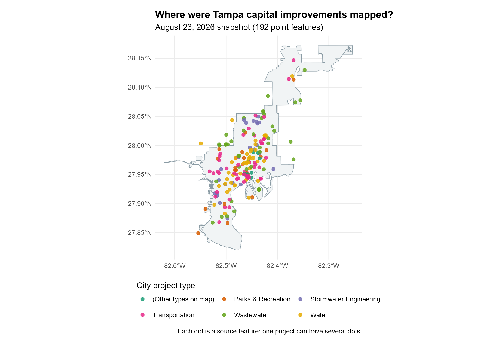
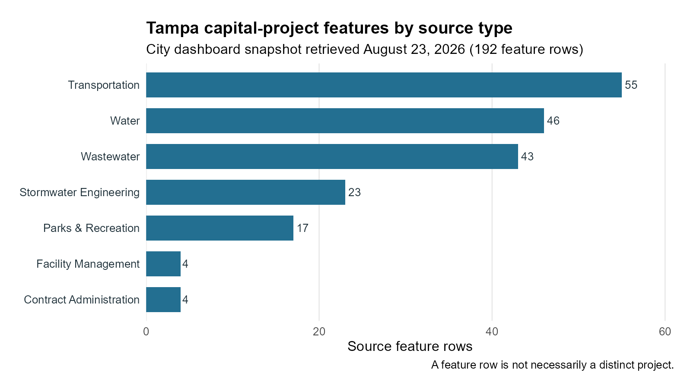

```{r setup, include=FALSE}
live_data <- identical(tolower(Sys.getenv("TAMPA_OPEN_DATA_LIVE")), "true")
knitr::opts_chunk$set(collapse = TRUE, comment = "#>", eval = live_data)
```

## Introduction

Capital improvement projects are public investments in things such as streets,
water systems, parks, and public buildings. A map can help us see where a city
has recorded this work and which kinds of work appear in different places. It
can also prompt useful questions about places that seem to have few mapped
projects.

In this tutorial, you will use the `tampaBayOpenData` package to find the City
of Tampa's public capital-project layer, download its mapped locations, and
color them by the project's type as recorded by the City. You will also make a
small table of those types and check whether multiple source rows share a
project identifier. The finished map shows *locations*, while the table counts
*source feature rows*. Neither is automatically a count of distinct projects.

You need basic R data-frame skills, but no GIS experience. The `sf` package
holds shapes and coordinates, and `ggplot2` draws the map. The live-data steps
are shown for you to run in order in an internet-connected R session. They do
not run during ordinary package checks or website builds. If you have a local
copy of this repository and want to render the article with current City data,
run `Sys.setenv(TAMPA_OPEN_DATA_LIVE = "true")` in R before calling
`rmarkdown::render("vignettes/mapping-capital-improvements.Rmd")`. Your results
may differ as the City updates its data.

## Find the data

Install the package and the two optional mapping packages if you need them.
`knitr` formats tables, and `rmarkdown` renders the article.

```r
install.packages("pak")
pak::pak("Jaclenga/tampaBayOpenData")
install.packages(c("sf", "ggplot2", "knitr", "rmarkdown"))
```

Search the package's **checked catalog**. This reads a bundled list, so it
does not contact a data publisher. The `jurisdiction` argument keeps the
search focused on Tampa.

```{r find-capital-data, eval=TRUE}
library(tampaBayOpenData)

project_matches <- tbod_search_datasets(
  "capital", jurisdiction = "tampa", source = "checked"
)
knitr::kable(
  project_matches[, c("id", "title", "publisher", "geometry_type")],
  caption = "Checked Tampa capital-project data"
)
```

The `capital-projects` entry is the City's public-facing capital-project
**point** layer. A point marks an individual location. A **line** could trace a
road or pipe; a **polygon** could outline a work area. The checked Tampa
catalog does not currently identify matching line or polygon *capital-project*
layers. The checked `city-boundary` polygon is useful as a background, but it
is not another set of projects. Even when several shapes depict the same
underlying work, they should not be added together as separate projects.

Check the source note and saved field names before using them. The `verified`
date is when the package checked the endpoint, not when each project was
updated.

```{r inspect-capital-data, eval=TRUE}
project_info <- tbod_dataset_info("capital-projects")
project_info[c("publisher", "source_url", "verified", "scope_note")]

project_fields <- c("OBJECTID", "projid", "projtype", "Neighborhood")
project_schema <- tbod_schema("capital-projects")
stopifnot(all(project_fields %in% project_schema$fields$name))
project_schema$fields[
  match(project_fields, project_schema$fields$name),
  c("name", "alias", "type")
]
```

`OBJECTID` identifies a map feature, `projid` is a source project identifier,
`projtype` contains the City's type label, and `Neighborhood` is the City's
neighborhood label. We will use only these fields and the geometry, which keeps
the download small.

## Download the data

`tbod_get_dataset()` retrieves the current records. `spatial = TRUE` asks for
an `sf` object: an ordinary table with a geometry column. `out_sr = 4326`
requests latitude and longitude coordinates for both layers. We retrieve all
matching records because a limited preview would give misleading category
shares. The checked project layer had hundreds of features in the repository's
dated example, rather than a large regional inventory.

```{r download-capital-data}
capital_projects <- tbod_get_dataset(
  "capital-projects",
  fields = project_fields,
  spatial = TRUE,
  out_sr = 4326,
  total_timeout = 180
)

tampa_boundary <- tbod_get_dataset(
  "city-boundary", fields = "OBJECTID",
  spatial = TRUE, out_sr = 4326
)
```

Stop with a clear message if either source has no features or if the download
is incomplete. The package records its source and retrieval time; keep that
information when sharing results. A server failure or changed field name also
stops the example rather than creating a substitute dataset.

```{r check-download}
project_source <- tbod_provenance(capital_projects)
boundary_source <- tbod_provenance(tampa_boundary)

if (!isTRUE(project_source$complete) ||
    !isTRUE(boundary_source$complete)) {
  stop("A source download was incomplete; try again later.")
}
if (nrow(capital_projects) == 0 || nrow(tampa_boundary) == 0) {
  stop("A source returned no map features; try again later.")
}
project_source[c("publisher", "source_url", "retrieved_at")]
```

The two layers must use the same coordinate reference system, or CRS, to line
up on the map. EPSG:4326 is the common latitude-longitude CRS requested above.

```{r check-coordinates}
if (!isTRUE(sf::st_crs(capital_projects)$epsg == 4326) ||
    !isTRUE(sf::st_crs(tampa_boundary)$epsg == 4326)) {
  stop("The map layers were not returned in EPSG:4326.")
}
```

## Prepare and categorize projects

Use the publisher's `projtype` values as categories. Trimming spaces makes
labels consistent without guessing what a description means. Missing or blank
values get an explicit `(Missing source type)` label. A check prevents that
label from merging with an actual source value. Add the source ID so it stays
clear where these records came from if you later combine data.

```{r clean-categories}
capital_projects$project_category <- trimws(
  as.character(capital_projects$projtype)
)
missing_type <- is.na(capital_projects$project_category) |
  capital_projects$project_category == ""
missing_label <- "(Missing source type)"
if (missing_label %in% capital_projects$project_category[!missing_type]) {
  stop("The source uses the missing-type display label; choose another label.")
}
capital_projects$project_category[missing_type] <- missing_label
capital_projects$source_dataset <- "capital-projects"

sort(unique(capital_projects$project_category))
```

The project identifier deserves a separate check. Blank identifiers are
treated as missing. Repeated nonblank values suggest that one project may
have several mapped points. Some nonblank values could also be placeholder
codes; the City would need to confirm their meaning before anyone uses IDs to
count distinct projects.

```{r inspect-project-ids}
capital_projects$project_id <- trimws(as.character(capital_projects$projid))
blank_id <- is.na(capital_projects$project_id) |
  capital_projects$project_id == ""
capital_projects$project_id[blank_id] <- NA_character_

known_ids <- capital_projects$project_id[
  !is.na(capital_projects$project_id)
]
id_frequency <- table(known_ids)

data.frame(
  check = c("Source feature rows", "Rows missing an ID", "IDs on multiple rows"),
  value = c(nrow(capital_projects),
            sum(is.na(capital_projects$project_id)),
            sum(id_frequency > 1))
)
```

These are checks on *feature rows and ID values*, not a project total. We do
not combine this point layer with other project geometries or remove rows
merely because an ID repeats.

## Create an infrastructure project map

First remove points with missing geometry from the map. Keep them in the
summary table: a record without coordinates still has a source category.

```{r prepare-map-points}
mapped_projects <- capital_projects[
  !sf::st_is_empty(capital_projects),
]
if (nrow(mapped_projects) == 0) {
  stop("No capital-project locations are available to map.")
}
```

To keep the legend short, show the five most common named source types **among
points with coordinates** in their own colors. Other named types share an
`(Other types on map)` color, while missing types retain their own label. This
groups labels **for display only**; the table below retains every source type.

```{r map-categories}
visible_type_counts <- as.data.frame(
  table(mapped_projects$project_category),
  stringsAsFactors = FALSE
)
names(visible_type_counts) <- c("project_category", "plotted_locations")
visible_type_counts <- visible_type_counts[
  order(visible_type_counts$plotted_locations, decreasing = TRUE),
]
named_types <- visible_type_counts$project_category[
  visible_type_counts$project_category != missing_label
]
top_types <- utils::head(named_types, 5)
```

```{r map-labels}
other_label <- "(Other types on map)"
if (other_label %in% mapped_projects$project_category) {
  stop("The source uses the map grouping label; choose another label.")
}
mapped_projects$map_category <- mapped_projects$project_category
other_type <- !mapped_projects$map_category %in%
  c(top_types, missing_label)
mapped_projects$map_category[other_type] <- other_label
```

The boundary is a light background. Project points sit on top and are colored
by the source type. `ggplot2` handles the shared CRS, and the legend names
the displayed categories.

```{r capital-project-map, fig.width=9, fig.height=6}
project_map <- ggplot2::ggplot() +
  ggplot2::geom_sf(data = tampa_boundary, fill = "#F1F4F5",
                   color = "#8A9BA4", linewidth = 0.3) +
  ggplot2::geom_sf(data = mapped_projects,
                   ggplot2::aes(color = map_category),
                   size = 1.8, alpha = 0.8) +
  ggplot2::scale_color_brewer(palette = "Dark2", name = "Source project type") +
  ggplot2::labs(
    title = "Where are Tampa's mapped capital improvements?",
    subtitle = "Public project locations from the City of Tampa",
    caption = "Each dot is a mapped feature; one project can have several dots."
  ) +
  ggplot2::theme_minimal(base_size = 12) +
  ggplot2::theme(axis.title = ggplot2::element_blank())
print(project_map)
```

The live code above creates a color-coded map from the checked catalog layer.
The map below provides a dated offline example using the City's related
[capital-project dashboard point layer](https://arcgis.tampagov.net/arcgis/rest/services/CapitalProjects/CapitalProjects/FeatureServer/0),
saved in a [public GeoJSON archive](https://github.com/Jaclenga/Tampa-Development-Records/blob/main/data/raw/capital_improvements.geojson)
on **August 23, 2026** ([retrieval note](https://github.com/Jaclenga/Tampa-Development-Records/blob/main/data/raw/snapshot_metadata.json)).
Its 192 points and their `projtype` labels were saved together. As in the live
code, the five most frequent types have their own colors, and the remaining
types share an `(Other types on map)` color. The dashboard is a separate City
service from the checked `capital-projects` endpoint, so its feature IDs and
counts should not be combined with a current download. The light backdrop is
the checked Tampa city boundary.



## Summarize the results

The table counts **source feature rows** by the City's project-type label. It
includes records without coordinates, so its counts may exceed the number of
points on your live map. The first row identifies the most frequent label in *your*
download; the answer can change as the publisher updates the layer.

```{r category-table}
category_summary <- as.data.frame(
  table(capital_projects$project_category), stringsAsFactors = FALSE
)
names(category_summary) <- c("project_category", "feature_rows")
category_summary <- category_summary[
  order(category_summary$feature_rows, decreasing = TRUE),
]
knitr::kable(
  category_summary,
  row.names = FALSE,
  caption = "City project-type labels by source feature row"
)
```

For a fixed example visible in this offline article, the small table below
counts the **192 dashboard point features** in the August 23 archive used for
the color map. These are not counts from the checked catalog endpoint. Run the
code above for current values from that endpoint.

| Source project type | Feature rows |
|:--------------------|-------------:|
| Transportation | 55 |
| Water | 46 |
| Wastewater | 43 |
| Stormwater Engineering | 23 |
| Parks & Recreation | 17 |
| Facility Management | 4 |
| Contract Administration | 4 |

Transportation has the most source feature rows in this snapshot (55),
followed by Water (46) and Wastewater (43). The bar chart repeats those counts;
the color map shows where the same archived features were recorded.



In the dated map, many dots cluster in central Tampa. Transportation and
Wastewater points also appear farther north and south. These are visual
impressions of published feature locations, not measured investment levels.

The City's `Neighborhood` field offers another simple view of concentration.
The first row in this table has the most source feature rows with that label.
These labels are not a spatial calculation, and some may be blank or missing.

```{r neighborhood-table}
capital_projects$source_neighborhood <- trimws(
  as.character(capital_projects$Neighborhood)
)
missing_neighborhood <- is.na(capital_projects$source_neighborhood) |
  capital_projects$source_neighborhood == ""
missing_neighborhood_label <- "(Missing neighborhood)"
if (missing_neighborhood_label %in%
    capital_projects$source_neighborhood[!missing_neighborhood]) {
  stop("The source uses the missing-neighborhood display label; choose another.")
}
capital_projects$source_neighborhood[missing_neighborhood] <-
  missing_neighborhood_label
neighborhood_summary <- as.data.frame(
  table(capital_projects$source_neighborhood), stringsAsFactors = FALSE
)
names(neighborhood_summary) <- c("source_neighborhood", "feature_rows")
neighborhood_summary <- neighborhood_summary[
  order(neighborhood_summary$feature_rows, decreasing = TRUE),
]
knitr::kable(utils::head(neighborhood_summary, 10), row.names = FALSE)
```

Look at the map to see whether some category colors are concentrated or
spread across Tampa. A cluster means more *features* are mapped there, not
necessarily more distinct projects or dollars. A project may have several
locations, and source coverage may vary by area. The map does not show
funding amounts, construction progress, or completed infrastructure.

## Limitations and next steps

This is the City's [public-facing capital-project
layer](https://tampa.maps.arcgis.com/home/item.html?id=2226a20de08641e38cedd1c2d7cac69e),
not a complete capital ledger. The checked catalog's verification date does
not measure the freshness of every record. Labels, identifiers, and locations
can be missing or updated; one project may have multiple point features.
The boundary is a shoreline-adjusted map representation, not a legal survey.
Geographic concentration alone cannot establish whether investment is fair:
population, need, project size, cost, and unmapped work would matter too.

To adapt this workflow, search the checked catalog for another topic or
publisher, inspect its source note and schema, then change the dataset ID and
field names. A true line or polygon project layer would need its own source
review and map symbol. Before combining layers, check whether their features
share project identifiers. The [advanced infrastructure
article](infrastructure-projects.html) explores ID, status, phase, and cost
fields in more detail.
