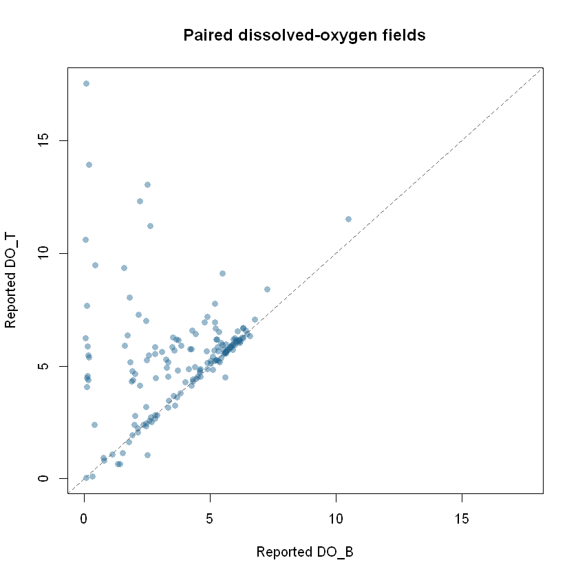

```{r setup, include=FALSE}
knitr::opts_chunk$set(collapse = TRUE, comment = "#>", eval = FALSE)
```

This tutorial uses the checked **Hillsborough EPC water-quality observations**
layer, a sample view from Hillsborough County monitoring stations rather than
region-wide coverage of Tampa Bay. It asks a modest question: how many records
contain both reported `DO_T` and `DO_B` measurements, and how do those paired
values compare? It extends the [short paired-reading exploration](https://github.com/Jaclenga/tampaBayOpenData/blob/main/explorations/stories/04-hillsborough-water-quality.Rmd)
with an offline source check, a missing-data audit, station and date summaries,
and a reproducible `ggplot2` chart.

The source is a view of the **latest staff-reviewed samples**, not a complete
monitoring history. The package checks its endpoint and schema; it does not
validate laboratory methods or establish measurement units. This is one
checked Hillsborough layer, not a survey of all Tampa Bay waters or monitoring
programs.

## Set up R

Install the package from GitHub and `ggplot2` for the optional plotting step.
The examples use base R for cleaning and summaries, so `ggplot2` is an
optional tutorial dependency, not a required package import.

```r
install.packages("pak")       # if needed
pak::pak("Jaclenga/tampaBayOpenData")
install.packages("ggplot2")   # if needed for the chart
library(tampaBayOpenData)
```

The catalog and saved schema chunks below run without a network connection
when this article is built. **Live** chunks are shown but not run during CRAN
or website builds. Run those chunks in order in an internet-connected R
session to analyze current observations. A source can change or be
temporarily unavailable; the retrieval code reports a failure instead of
substituting old data.

## Find the checked monitoring layer

Search the curated catalog locally. `source = "checked"` avoids a live portal
scan and returns stable package IDs.

```{r water-catalog, eval=TRUE}
library(tampaBayOpenData)

water <- tbod_search_datasets("water quality", source = "checked")
water[, c("id", "title", "publisher", "category", "validation_status")]

id <- "hillsborough-water-quality"
info <- tbod_dataset_info(id)
info[c("publisher", "title", "source_url", "verified", "scope_note")]
```

The `verified` date marks the catalog's endpoint check, **not** a sampling
date. The [ArcGIS source item](https://hillsborough.maps.arcgis.com/home/item.html?id=04f8f5d7491b4d7aa2aacc6df7ea7f13)
is published through Hillsborough County for its Environmental Protection
Commission. Read the item's terms before reusing results; the checked catalog
does not identify an unrestricted reuse license for this layer.

The package also offers [live discovery](discovery.html). It may find other
water-related items, but a live search depends on portal indexing and is not
proof of complete regional coverage.

```{r water-live-discovery}
found <- tbod_search_datasets("water quality", source = "live",
                              jurisdiction = "hillsborough", max_items = 10)
found[, c("id", "title", "publisher", "validation_status")]
attr(found, "discovery_complete")
```

## Check fields, locations, dates, and units

The saved layer schema identifies `StationNumber` and `AreaName` as location
labels, `SampleTime` as an ArcGIS date field, `DO_T` and `DO_B` as numeric
fields, and `ID` as the object ID. Its geometry is a point. These are actual
source field names; the saved schema does **not** provide measurement units
or a sampling protocol for the two oxygen fields.

```{r water-schema, eval=TRUE}
schema <- tbod_schema(id)
needed <- c("ID", "StationNumber", "AreaName", "SampleTime", "DO_T", "DO_B")
stopifnot(all(needed %in% schema$fields$name))
schema$fields[schema$fields$name %in% needed, c("name", "type")]
schema$geometry_type
```

Inspect the current service metadata before analysis. The package compares
it with this bundled baseline again during retrieval and stops on
incompatible changes. If source units, depth meanings, or quality-control
codes matter to your question, confirm them in the publisher's current
documentation; field names alone are insufficient.

## Retrieve and audit current observations

This requests the full current layer with just the fields used here. It checks
the retrieval provenance before analysis so a partial result is never treated
as a complete view. The request can fail because a service is unavailable,
its schema changed, or the operation exceeded its time budget.

```{r water-retrieve}
current <- tryCatch(
  tbod_dataset_info(id, refresh = TRUE, total_timeout = 90),
  error = function(e) stop("Could not inspect the current EPC layer: ",
                           conditionMessage(e), call. = FALSE)
)
if (!all(needed %in% current$fields$name)) {
  stop("The current EPC layer lacks a field used in this tutorial.",
       call. = FALSE)
}

samples <- tryCatch(
  tbod_get_dataset(id, fields = needed, total_timeout = 240),
  error = function(e) stop("Could not retrieve the complete EPC sample view: ",
                           conditionMessage(e), call. = FALSE)
)
source <- tbod_provenance(samples)
if (!isTRUE(source$complete) ||
    !isTRUE(source$returned_rows == nrow(samples)) ||
    !isTRUE(source$matched_rows == nrow(samples))) {
  stop("EPC retrieval was incomplete; do not interpret these records.",
       call. = FALSE)
}
if (!inherits(samples$SampleTime, c("POSIXct", "Date"))) {
  stop("SampleTime was not returned as a usable date; inspect its time zone metadata.",
       call. = FALSE)
}
source[c("publisher", "source_url", "retrieved_at", "matched_rows",
         "complete", "integrity")]
str(samples[, needed])
head(samples[, needed])
```

`tbod_get_dataset()` converts the UTC ArcGIS `SampleTime` value to an R date-time
when the current metadata still declares that time reference. Source column
names are preserved. The full retrieval checks object-ID membership, but
live attributes can still change during a request.

Clean blank station and area labels, retain only finite numbers for paired
measurement calculations, and report exclusions. A missing `DO_T` or `DO_B`
is **not** a zero reading.

```{r water-clean}
clean <- data.frame(
  station = trimws(as.character(samples$StationNumber)),
  area = trimws(as.character(samples$AreaName)),
  sample_date = as.Date(samples$SampleTime, tz = "UTC"),
  do_t = as.numeric(samples$DO_T),
  do_b = as.numeric(samples$DO_B)
)
clean$station[is.na(clean$station) | !nzchar(clean$station)] <- NA_character_
clean$area[is.na(clean$area) | !nzchar(clean$area)] <- NA_character_

has_pair <- is.finite(clean$do_t) & is.finite(clean$do_b)
audit <- data.frame(
  check = c("All retrieved records", "Distinct nonblank station IDs",
            "Missing or nonfinite DO_T", "Missing or nonfinite DO_B",
            "Records with both oxygen fields"),
  count = c(nrow(clean), length(unique(stats::na.omit(clean$station))),
            sum(!is.finite(clean$do_t)), sum(!is.finite(clean$do_b)),
            sum(has_pair))
)
print(audit, row.names = FALSE)

paired <- clean[has_pair, , drop = FALSE]
paired$difference <- paired$do_t - paired$do_b
```

Summarize site coverage and sample dates separately from the oxygen
comparison. This is a snapshot of the current view: the month table describes
which dates are present, **not** a trend or a consistent monthly sampling
schedule.

```{r water-summary}
station_counts <- sort(table(clean$station, useNA = "no"), decreasing = TRUE)
head(station_counts, 10)

dated <- clean$sample_date[!is.na(clean$sample_date)]
if (length(dated)) {
  range(dated)
  month_counts <- sort(table(format(dated, "%Y-%m")), decreasing = TRUE)
  head(month_counts, 12)
} else {
  message("No sample dates were returned.")
}

areas <- split(paired$difference[!is.na(paired$area)],
               paired$area[!is.na(paired$area)])
if (length(areas)) {
  by_area <- data.frame(
    area = names(areas),
    paired_records = vapply(areas, length, integer(1)),
    median_do_t_minus_do_b = vapply(areas, median, numeric(1))
  )
  by_area <- by_area[order(-by_area$paired_records), , drop = FALSE]
  print(by_area, row.names = FALSE)
} else {
  message("No paired records have a nonblank area label.")
}
```

The `by_area` median is a descriptive comparison of the two **reported**
fields, with units unconfirmed. Records may cover stations or dates unevenly;
do not rank areas as better or worse water quality from this table.

## Plot paired readings

The image below is an **archived illustration**, generated by the linked
exploration from a full layer retrieval on **October 6, 2026**. It is not a
current measurement or the output of this article's live code. Points on the
dashed diagonal have equal reported `DO_T` and `DO_B`; points away from it
have different values. The original run reported 263 records, of which 161
contained both fields.



Run this `ggplot2` code after the live retrieval to make the same comparison
for today's view. It stops with an informative message if no paired readings
are available.

```{r water-plot, fig.width=7, fig.height=5}
if (!nrow(paired)) {
  stop("No records have both DO_T and DO_B; there is nothing to plot.",
       call. = FALSE)
}
if (!requireNamespace("ggplot2", quietly = TRUE)) {
  stop("Install ggplot2 to draw the oxygen comparison.", call. = FALSE)
}

oxygen_plot <- ggplot2::ggplot(paired, ggplot2::aes(x = do_b, y = do_t)) +
  ggplot2::geom_point(color = "#256789", alpha = 0.55, size = 2) +
  ggplot2::geom_abline(slope = 1, intercept = 0, linetype = "dashed",
                       color = "#555555") +
  ggplot2::coord_equal() +
  ggplot2::labs(
    title = "Paired oxygen fields in the current EPC view",
    subtitle = paste(nrow(paired), "records with both reported values"),
    x = "Reported DO_B (units not confirmed here)",
    y = "Reported DO_T (units not confirmed here)",
    caption = paste("Hillsborough EPC station sample view via tampaBayOpenData;",
                    "not region-wide Bay coverage")
  ) +
  ggplot2::theme_minimal(base_size = 12)
print(oxygen_plot)
```

## Interpret and reproduce the analysis

The chart compares two values **within records that report both**. Excluded
records can differ systematically from included ones. `StationNumber` and
`AreaName` describe source labels, not independently verified locations; the
point layer's site coverage is not known to be comprehensive. The source
view cannot establish historical improvement, regulatory compliance, safety
for swimming or drinking, or a cause of any difference. Confirm field units,
sampling depths, detection limits, methods, and quality flags with the
publisher before making environmental or policy claims.

For a reproducible report, record the output of `tbod_provenance(samples)`,
the package version from `packageVersion("tampaBayOpenData")`, the retrieval
time, the fields selected, and the date you consulted the source item. Save
the retrieved object and provenance together if you need to revisit a dated
analysis. The package does not archive source records.

Continue with [housing and development](housing-development.html),
[infrastructure and capital projects](infrastructure-projects.html), or the
[Data Coverage dashboard](coverage.html) for the checked catalog's scope and
verification status.
