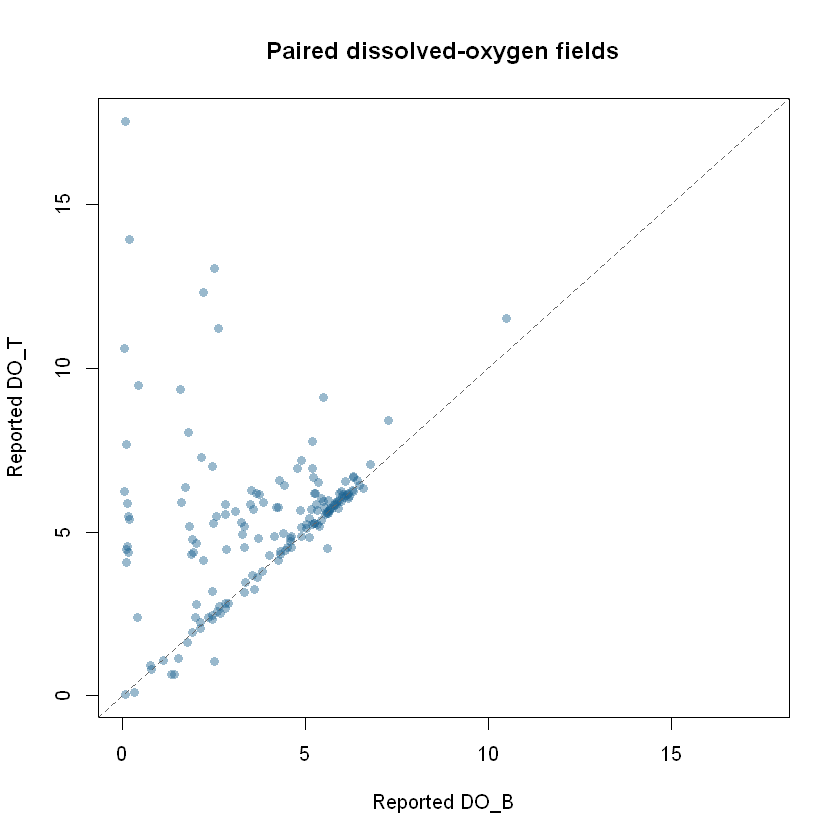

```{r setup, include=FALSE}
knitr::opts_chunk$set(collapse = TRUE, comment = "#>", eval = FALSE)
```

Compare reported `DO_T` and `DO_B` oxygen readings in Hillsborough EPC records.

The layer contains the latest staff-reviewed samples, not a full history
or region-wide survey. Confirm units and methods with the publisher.

## Set up R

Install the package and `ggplot2` for plotting:

```r
install.packages("tampaBayOpenData")
install.packages("ggplot2")   # if needed for the chart
library(tampaBayOpenData)
```

Catalog examples run offline. Run live examples in order with internet access.

## Find data

Search the offline catalog:

```{r water-catalog, eval=TRUE}
library(tampaBayOpenData)

water <- tbod_search_datasets("water quality", source = "checked")
water[, c("canonical_id", "publisher", "title", "category", "validation_status")]

id <- "hillsborough-water-quality"
info <- tbod_dataset_info(id)
info[c("publisher", "title", "source_url", "verified", "scope_note")]
```

Check the [source item](https://hillsborough.maps.arcgis.com/home/item.html?id=04f8f5d7491b4d7aa2aacc6df7ea7f13)
and its terms. `verified` dates an endpoint check, not a sample.

Use [live discovery](discovery.html) to find other layers.

```{r water-live-discovery}
found <- tbod_search_datasets("water quality", source = "live",
                              jurisdiction = "hillsborough", max_items = 10)
found[, c("canonical_id", "publisher", "title", "validation_status")]
attr(found, "discovery_complete")
```

## Check fields

`StationNumber` and `AreaName` label locations, `SampleTime` gives the
sample time, and `DO_T` and `DO_B` hold numeric readings.

```{r water-schema, eval=TRUE}
schema <- tbod_schema(id)
needed <- c("ID", "StationNumber", "AreaName", "SampleTime", "DO_T", "DO_B")
stopifnot(all(needed %in% schema$fields$name))
schema$fields[schema$fields$name %in% needed, c("name", "type")]
schema$geometry_type
```

Check current metadata and confirm units, depths, and quality codes
with the publisher before interpreting differences.

## Retrieve and clean

Retrieve the full layer and check completeness:

```{r water-retrieve}
current <- tryCatch(
  tbod_dataset_info(id, refresh = TRUE, total_timeout = 90),
  error = function(e) stop("Could not inspect the current EPC layer: ",
                           conditionMessage(e), call. = FALSE)
)
if (!all(needed %in% current$fields$name)) {
  stop("The current EPC layer lacks a field used in this tutorial.",
       call. = FALSE)
}

samples <- tryCatch(
  tbod_get_dataset(id, fields = needed, total_timeout = 240),
  error = function(e) stop("Could not retrieve the complete EPC sample view: ",
                           conditionMessage(e), call. = FALSE)
)
source <- tbod_provenance(samples)
if (!isTRUE(source$complete) ||
    !isTRUE(source$returned_rows == nrow(samples)) ||
    !isTRUE(source$matched_rows == nrow(samples))) {
  stop("EPC retrieval was incomplete; do not interpret these records.",
       call. = FALSE)
}
if (!inherits(samples$SampleTime, c("POSIXct", "Date"))) {
  stop("SampleTime was not returned as a usable date; inspect its time zone metadata.",
       call. = FALSE)
}
source[c("publisher", "source_url", "retrieved_at", "matched_rows",
         "complete", "integrity")]
str(samples[, needed])
head(samples[, needed])
```

Each row is an observation; stations may appear more than once.

`SampleTime` becomes an R date-time when the metadata declares UTC.

Clean blank labels and count missing readings. Missing values are not zeros.

```{r water-clean}
clean <- data.frame(
  station = trimws(as.character(samples$StationNumber)),
  area = trimws(as.character(samples$AreaName)),
  sample_date = as.Date(samples$SampleTime, tz = "UTC"),
  do_t = as.numeric(samples$DO_T),
  do_b = as.numeric(samples$DO_B)
)
clean$station[is.na(clean$station) | !nzchar(clean$station)] <- NA_character_
clean$area[is.na(clean$area) | !nzchar(clean$area)] <- NA_character_

has_pair <- is.finite(clean$do_t) & is.finite(clean$do_b)
audit <- data.frame(
  check = c("All retrieved records", "Distinct nonblank station IDs",
            "Missing or nonfinite DO_T", "Missing or nonfinite DO_B",
            "Records with both oxygen fields"),
  count = c(nrow(clean), length(unique(stats::na.omit(clean$station))),
            sum(!is.finite(clean$do_t)), sum(!is.finite(clean$do_b)),
            sum(has_pair))
)
print(audit, row.names = FALSE)

paired <- clean[has_pair, , drop = FALSE]
paired$difference <- paired$do_t - paired$do_b
```

The final audit row counts usable pairs. Missing-field counts can overlap.

Summarize stations and dates. The month table describes available samples,
not a historical trend or regular sampling schedule.

```{r water-summary}
station_counts <- sort(table(clean$station, useNA = "no"), decreasing = TRUE)
head(station_counts, 10)

dated <- clean$sample_date[!is.na(clean$sample_date)]
if (length(dated)) {
  range(dated)
  month_counts <- sort(table(format(dated, "%Y-%m")), decreasing = TRUE)
  head(month_counts, 12)
} else {
  message("No sample dates were returned.")
}

areas <- split(paired$difference[!is.na(paired$area)],
               paired$area[!is.na(paired$area)])
if (length(areas)) {
  by_area <- data.frame(
    area = names(areas),
    paired_records = vapply(areas, length, integer(1)),
    median_do_t_minus_do_b = vapply(areas, median, numeric(1))
  )
  by_area <- by_area[order(-by_area$paired_records), , drop = FALSE]
  print(by_area, row.names = FALSE)
} else {
  message("No paired records have a nonblank area label.")
}
```

`by_area` summarizes paired observations and their median within-record
`DO_T - DO_B` difference.

Uneven station coverage and unconfirmed units prevent water-quality rankings.

## Plot paired readings

Archived chart, October 6, 2026: 161 of 263 records had both readings.
The dashed line marks equal values.



Plot current pairs after running the retrieval:

```{r water-plot, fig.width=7, fig.height=5}
if (!nrow(paired)) {
  stop("No records have both DO_T and DO_B; there is nothing to plot.",
       call. = FALSE)
}
if (!requireNamespace("ggplot2", quietly = TRUE)) {
  stop("Install ggplot2 to draw the oxygen comparison.", call. = FALSE)
}

oxygen_plot <- ggplot2::ggplot(paired, ggplot2::aes(x = do_b, y = do_t)) +
  ggplot2::geom_point(color = "#256789", alpha = 0.55, size = 2) +
  ggplot2::geom_abline(slope = 1, intercept = 0, linetype = "dashed",
                       color = "#555555") +
  ggplot2::coord_equal() +
  ggplot2::labs(
    title = "Paired oxygen fields in the current EPC view",
    subtitle = paste(nrow(paired), "records with both reported values"),
    x = "Reported DO_B (units not confirmed here)",
    y = "Reported DO_T (units not confirmed here)",
    caption = paste("Hillsborough EPC station sample view via tampaBayOpenData;",
                    "not region-wide Bay coverage")
  ) +
  ggplot2::theme_minimal(base_size = 12)
print(oxygen_plot)
```

## Read the chart and save the results

The chart includes only records with both readings. It cannot establish
trends, causes, regulatory compliance, or swimming and drinking safety.
Review units, sampling methods, and excluded records before further comparisons.

Save `samples`, its provenance, and the package version with your results.
The package does not archive source records.

See [coverage](coverage.html) for source limits.
